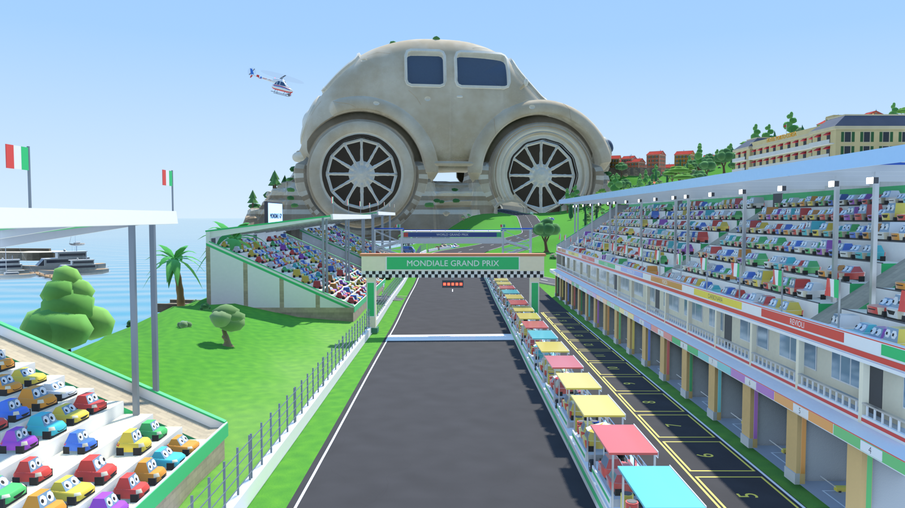
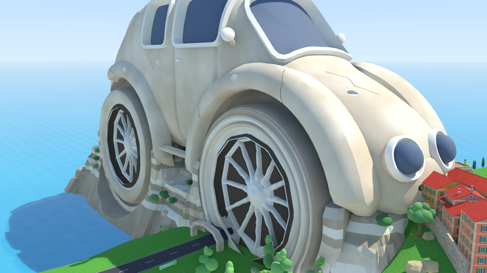
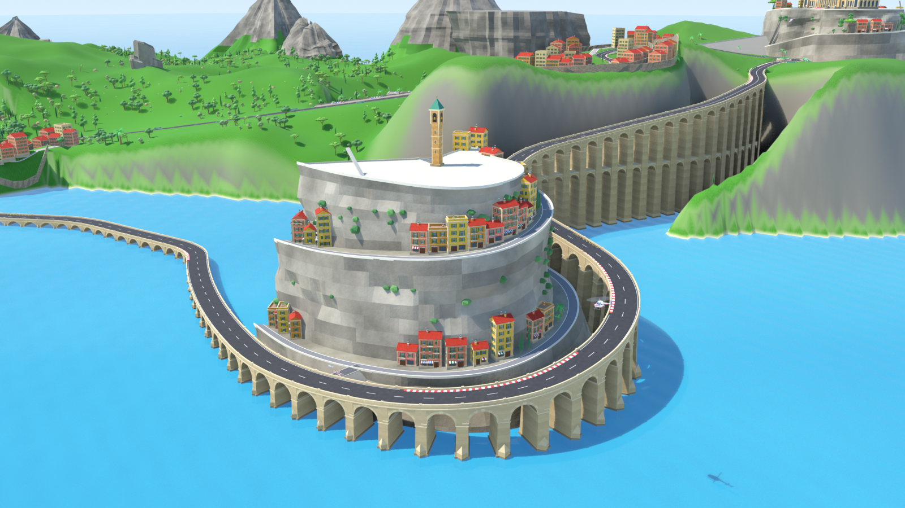
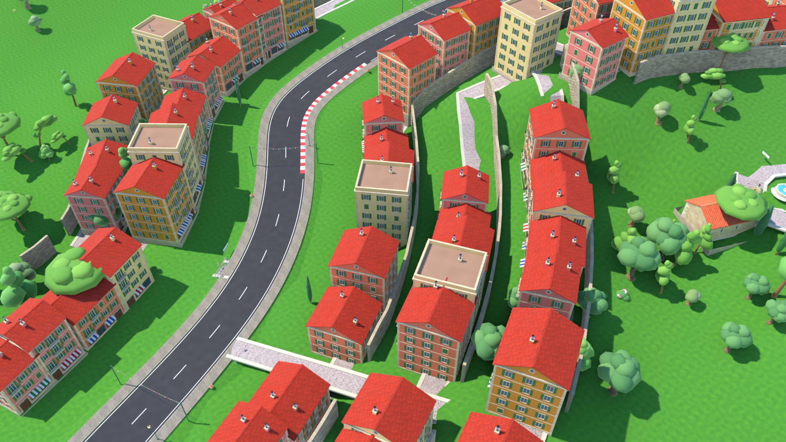
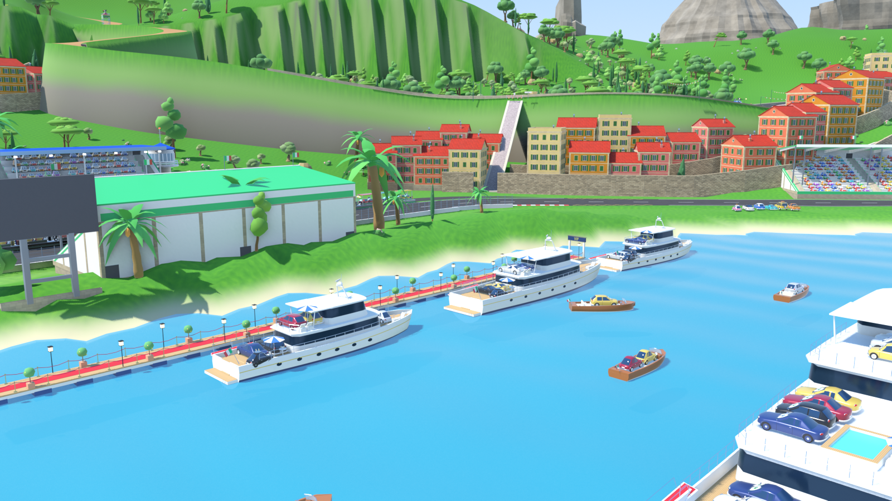
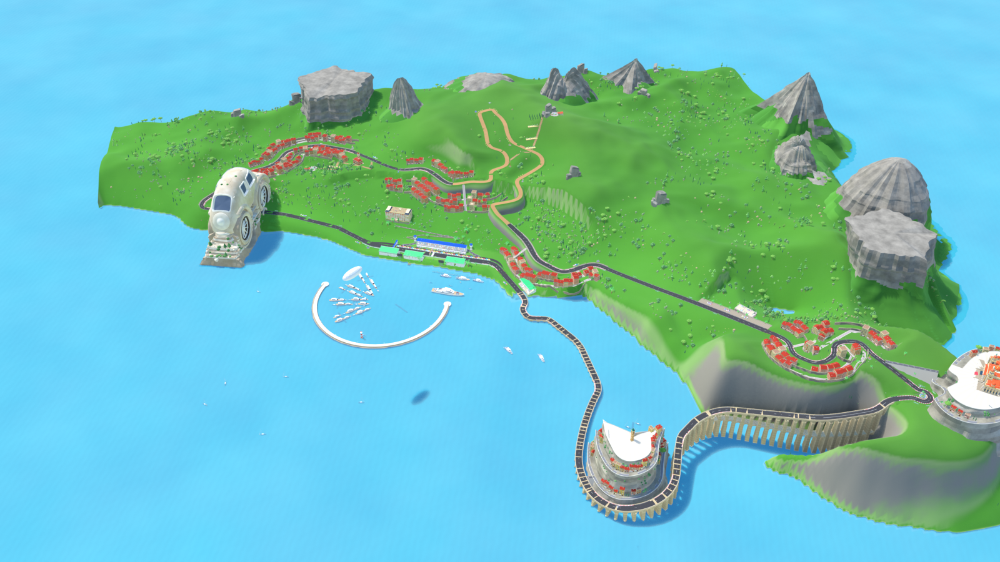

# Porto Corsa (Cars 2) — circuito para Assetto Corsa

Mod de fans, sin ánimo de lucro, del circuito de **Porto Corsa** (Cars 2) para
Assetto Corsa, generado 100 % por código con Blender 5.1: trazado de 5,2 km y
50 curvas, sección de tierra, rotonda Loews, viaducto de arcos, rocas-pueblo con
carretera en espiral, casino sobre su promontorio, coche-fósil gigante con el
túnel bajo su rueda, 20 boxes con tribuna, pueblo en terrazas, yates VIP…

**Descarga del mod y del vídeo:** pestaña **Releases** de este repositorio
(`porto_corsa_mod.zip` → arrastrar a Content Manager → Install → Drive).
Instrucciones completas en [`04_export/INSTRUCCIONES.md`](04_export/INSTRUCCIONES.md).

Cars 2 © Disney/Pixar. Este proyecto no es oficial ni está afiliado a Disney,
Pixar o Kunos Simulazioni; no distribuir con ánimo de lucro.

## Capturas

| | |
|---|---|
|  |  |
|  |  |
|  |  |

Más vistas en `03_blender/renders/capturas/` (recorrido del circuito),
`03_blender/renders/inspeccion/` (baldosas cenitales y oblicuas del mapa entero)
y `03_blender/assets/previews/` (cada asset por separado).

## Estructura

| Carpeta | Qué hay |
|---|---|
| `01_referencias/` | Investigación (texto). Las imágenes de referencia de la película no se publican. |
| `02_trazado/` | Extracción del trazado desde el mapa oficial (SVG → `trazado_v1.json`). |
| `03_blender/` | Pipeline completo: `preparar_geometria.py` → `construir_pista.py` → `integrar_escena.py` → inspectores → materiales/texturas → renders. `assets/` = kits procedurales (casino, casas, viaducto, rocas-pueblo, pit, montañas, yates, kit italiano…) con sus tests y previews. |
| `04_export/` | Exportación a Assetto Corsa: `exportar_ac.py` (mallas físicas, parrilla, boxes), `kn5_writer*.py` (escritor KN5 propio, sin ksEditor), `kn5_check.py` (lector/validador), `empaquetar.py` (zip), `INSTRUCCIONES.md`. |

## Regenerar todo desde cero

Requisitos: Windows, Blender 5.1 en `C:\Program Files\Blender Foundation\Blender 5.1\`,
Python 3.12 con `numpy scipy scikit-image svgpathtools Pillow imageio-ffmpeg`.

```
cd 03_blender
python preparar_geometria.py
blender --background --factory-startup --python construir_pista.py
blender --background --factory-startup --python integrar_escena.py
blender --background --factory-startup --python revisar_flotantes.py
blender --background --factory-startup --python revisar_invasores.py
blender --background --factory-startup --python eliminar_sumergidos.py
blender --background --factory-startup --python revisar_coches.py
blender --background --factory-startup --python revisar_tunel.py
blender --background --factory-startup --python mejorar_materiales.py
blender --background --factory-startup --python aplicar_texturas.py
blender --background --factory-startup --python renderizar_capturas.py
cd ..\04_export
blender --background --factory-startup --python exportar_ac.py
blender --background --factory-startup --python kn5_writer_opt.py
python kn5_check.py kn5\porto_corsa_opt.kn5 kn5\informe_check_opt.json
python empaquetar.py
```

(`construir_pista.py` debe ejecutarse siempre antes de `integrar_escena.py`:
el integrador lee y sobrescribe el mismo `porto_corsa.blend`.)

Hecho por Arnau con Claude (Anthropic).
